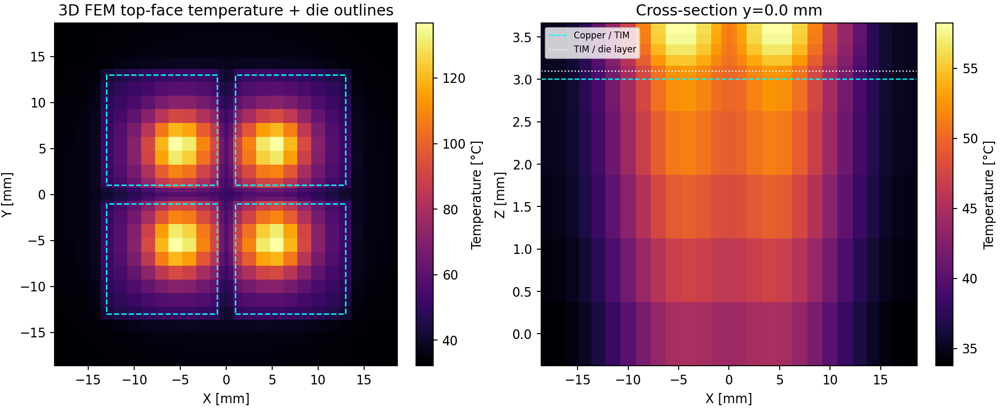
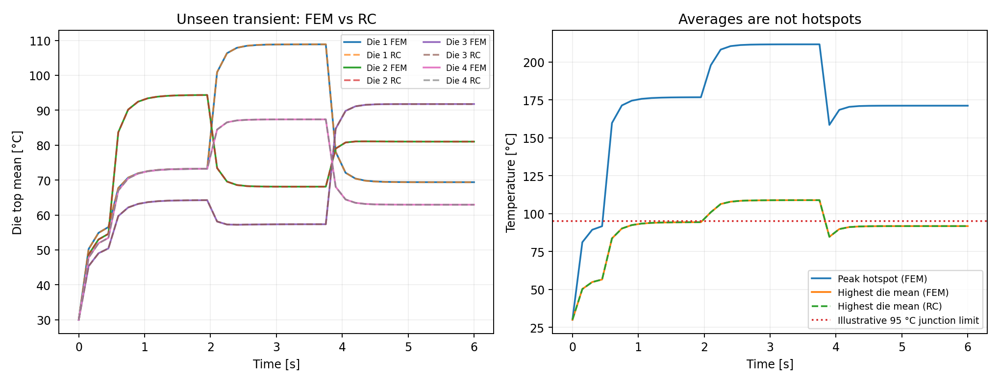
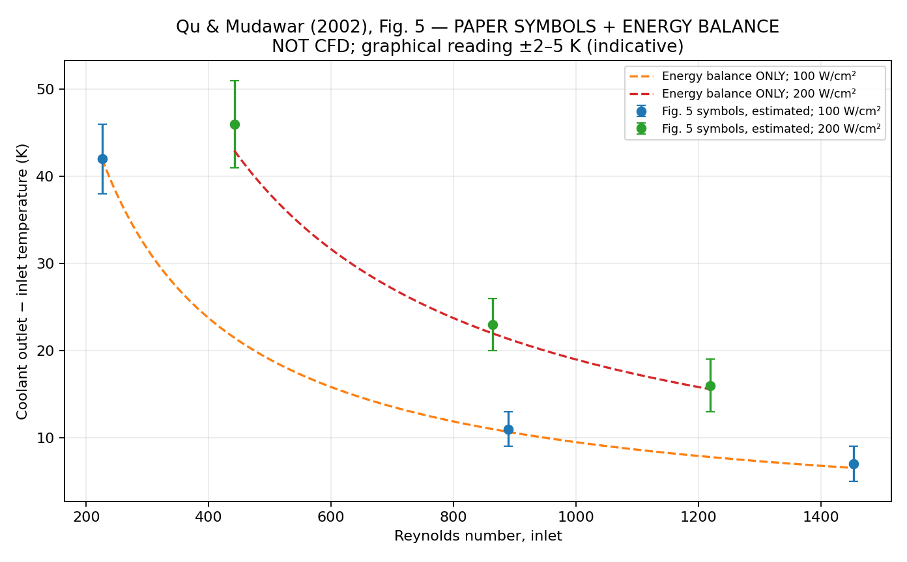
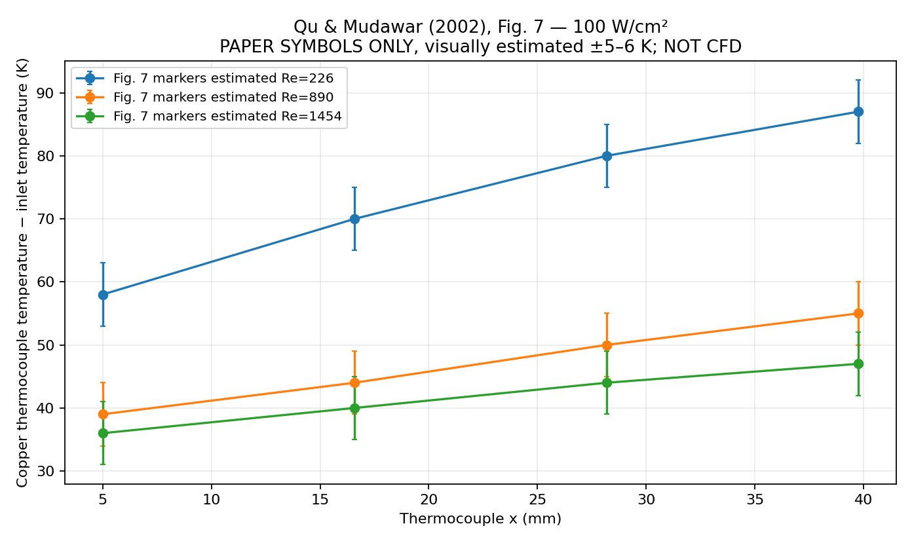
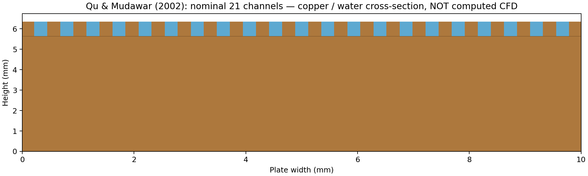
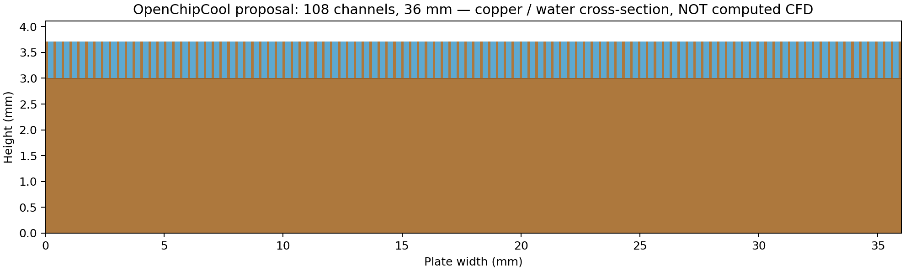
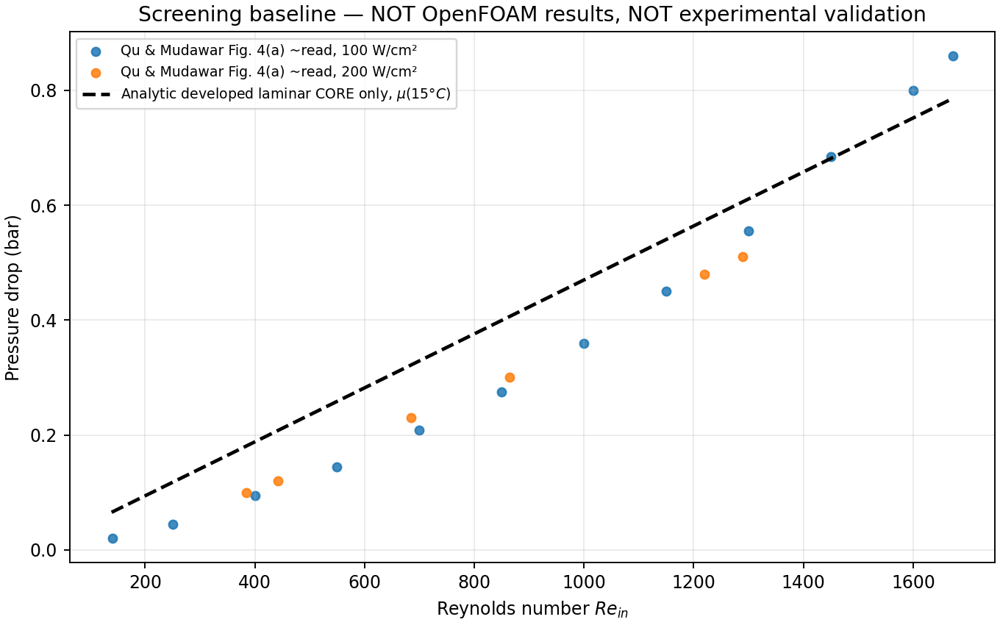

# OpenChipCool — Multiscale Thermal Digital Twin

**v0.4 — Reproducible open-source CAE portfolio project**: a four-chiplet thermal
benchmark connecting 3D heat-conduction FEM, a compact transient RC model and
a simplified 1D coolant loop (Python / OpenModelica). A Streamlit dashboard
explores workload transients and a pump-flow fault.

> **Engineering status: numerical demonstration — NOT experimental validation.**
> This model represents a made-up 800 W accelerator, not actual Semidynamics
> or other commercial chip data. In particular, the convective coefficient is
> a simplified *equivalent* HTC anchored to published CFD Nusselt curves
> (Qu & Mudawar, 2002), **not** independently validated for this package.





## v0.4 — experimental-validation workflow, still **NOT RUN**

**Repository:** https://github.com/mitjasha/OpenChipCool.
The initial repository import preserves the v0.4 source and reproducible workflow;
the large generated HTML report and VTK point cloud are distributed in the
archived v0.4 release bundle rather than checked into Git. CFD validation
remains unperformed until OpenFOAM runs are available.

**OpenFOAM.com was not available** (including `blockMesh`; the attempted executable
check returned exit code 2), and external package hosts were not resolvable.
Consequently no mesh was checked by OpenFOAM, no actual CHT solution or measured
comparison exists, and the entire chain is **not experimentally validated**.

New in v0.4:

- [Detailed Russian validation plan](docs/validation_plan_RU.md): literature sources,
  published Fig. 4, 5 and 7 observables, physical gaps in the model, and
  evidence-based acceptance conditions.
- `scripts/build_validation_matrix.py`: 18 **input** cases, six published
  operating-point families × three physically refined hex meshes.
- `scripts/run_openfoam_matrix.py --execute`: fail-closed meshing/region check
  and solver runner, stores real log files *if a solver is available*.
- `water_properties.py` + `thermophysicalProperties`: IAPWS SR6-08(2011)
  tabulated temperature-dependent water viscosity/thermal conductivity,
  checked in Python against a published verification point; OpenFOAM runtime
  compatibility has not yet been assessed.
- `controlDict` function objects for patch area-average pressure, mass flow,
  mass-weighted outlet water temperature, and four copper thermocouple positions.
- `scripts/extract_openfoam_result.py` and `scripts/validate_all_figures.py`
  refuse to manufacture CFD measurements from analytical or paper data.
  Published graph readings are manually estimated and carry indicative
  uncertainty columns — not authors' raw experimental data.
- Standalone Fig. 5 and Fig. 7 *reference-only* plots labelled **NOT CFD**.

Run after installing this Python project:

```bash
python scripts/build_validation_matrix.py --output cfd_cases/validation_matrix
python scripts/plot_figure_references.py       # literature/energy only; NOT CFD
pytest -q
# On a sourced, actually installed OpenFOAM.com v2312 host ONLY:
python scripts/run_openfoam_matrix.py cfd_cases/validation_matrix/qm_q100_Re890_coarse --execute
```

Do not characterize the v0.4 benchmark as complete experimental validation:
upper polycarbonate cover conduction, the three deep transverse slots,
thermocouple holes and the physical inlet/outlet plenums are still absent
from the generated core model. Numerically validated **core CHT**, once run,
would not be equivalent to experimental validation of the full test fixture.





## v0.3 extension: Qu & Mudawar (2002) OpenFOAM CHT benchmark (prepared, not solved)

A new CHT case generator creates a **21-channel copper/water conformal blockMesh** modeled after Qu & Mudawar, *IJHMT* 45 (2002), DOI https://doi.org/10.1016/S0017-9310(01)00337-4. It also creates a deliberately separate **36 × 36 mm, 108-channel cold-plate concept** at 800 W, 30°C coolant and 4 L/min. These are **not CFD results**: `chtMultiRegionSimpleFoam`, `blockMesh`, `checkMesh` and `omc` are unavailable in this runtime. The original experimental plenums, thermocouple holes, heater slots and conductive cover are not fully modeled, so the initial OpenFOAM core is **not** a complete reproduction of the experimental test fixture.

**New deliverables:** 21/108-channel parametrized geometry generator, 3 systematic mesh levels, audited block-face topology, region and boundary-condition scaffold for OpenFOAM.com v2312, source-annotated approximate pressure markers, strictly labeled analytical laminar baseline chart, and fail-closed CFD-vs-experiment comparison script. **No CHT validation claim or replacement of the earlier placeholder `h(flow)` is justified yet.**

```bash
python scripts/prepare_openfoam.py --profile paper --level coarse --Re 890 --qeff 100 --case cfd_cases/qm890
python scripts/cfd_reference_report.py         # explicitly analytical, NOT CFD
# ONLY when an OpenFOAM.com toolchain is installed and sourced:
python scripts/prepare_openfoam.py --profile paper --level coarse --Re 890 --qeff 100 --case cfd_cases/qm890 --mesh
# inspect the generated boundary conditions, then run the installed steady CHT solver
```

See [full experiment-to-CFD protocol](docs/qu_mudawar_openfoam_protocol.md) and [honest evidence status](docs/cfd_status.md).







## What is implemented (iteration 2)

| Capability | Implementation | Current scope |
|---|---|---|
| 3D thermal FEM | Conforming, linear-tetrahedral sparse Galerkin solver using NumPy/SciPy | Real 3D steady and transient conduction; silicon die islands, epoxy mold, TIM, copper base |
| Heterogeneous power maps | Four independently powered chiplets, offset Gaussian hotspots | Source normalized to the exact supplied power per die |
| Reduced RC | 4 die junction-average + 4 copper-quadrant thermal nodes | Physical positive R/C model; fit to FEM training; reported separate hold-out error |
| 1D liquid-cooling loop | Well-mixed coolant capacitance, coldplate heat transfer, constant-UA radiator | Python and exported standalone OpenModelica model; unvalidated pump-stop h(flow) extrapolation |
| Dashboard | Streamlit + Plotly | Workload, die power and pump-flow fault; uses fast RC model only |
| Verification | Pytest, stationary and transient energy conservation, mesh-study CLI | **No** experimental validation or own CFD; paper CFD Nu / unvalidated flow extrapolation; no pump curve |

## Quick start

Python 3.10+:

```bash
python -m venv .venv
source .venv/bin/activate                  # Windows: .venv\\Scripts\\activate
python -m pip install -e '.[dashboard,dev]'
pytest -q
python -m openchipcool.cli benchmark --refinement 2 --output results
streamlit run dashboard.py
```

Generated files:

- `results/benchmark.png` — FEM vs RC **unseen** power transient, plus FEM
  hotspot peaks (which are *not* predicted by the RC model).
- `results/holdout_comparison.csv` — die averages and peaks vs time.
- `results/steady_temperature_points.csv` — 3D FEM nodal temperature field.
- `results/steady_temperature.vtk` — open directly in ParaView.
- `results/temperature_field.png` — die-top view and vertical FEM temperature slice.
- `results/mesh_study_aligned.csv`, `.png` and `mesh_gci.json` — 3D systematic refinement and cautious GCI estimates (not a convergence certificate).
- `results/interactive_report.html` — self-contained Plotly RC/1D scenario viewer,
  when Plotly is installed (no Streamlit server needed).
- `results/benchmark_summary.json` — mesh, energy balance, held-out error.
- `results/rc_calibration.json` — calibrated parameters consumed by dashboard.
- `results/OpenChipCoolLoop.mo` — Modelica loop exported from **the same RC**.

Explore mesh dependence separately:

```bash
python -m openchipcool.cli mesh-study --refinements 1,2,3 --output results
```

The new mesh study aligns all chip edges and three material layers and
refines all axes. It reports `results/mesh_gci.json` and
`results/mesh_study_aligned.csv` plus a figure. Use GCI cautiously;
three grids cannot guarantee asymptotic convergence for peak temperatures.

## OpenModelica

The `.mo` file is generated by the benchmark so its RC coefficients match the
Python model. If `omc` is installed:

```bash
omc --version
omc modelica/simulate.mos
```

To attempt an execution check: `python scripts/verify_openmodelica.py`.
This runs `results/OpenChipCoolLoop.mo` for 60 seconds with a power step, a
single-chip power pulse and a pump-flow reduction. OpenModelica itself is **not
required** for the Python benchmark and was **not** installed in the initial
build environment, so a successful OpenModelica simulation has not been
claimed. The model is intentionally lumped, not a `Modelica.Fluid` pipe/pump
network. GitHub Actions contains an **unverified (until it runs)**
`modelica-smoke` job to install `omc`, compile, run and compare the final die
temperatures to the Python ODE. Local verification still returns code 2
if `omc` is absent. `modelica/simulate.mos` includes a simple execution script.

## Physical assumptions

| Parameter | Synthetic value |
|---|---:|
| Package base | 36 × 36 × 3 mm copper |
| Four dies | 12 × 12 × 0.5 mm silicon, 14 mm pitch |
| Thermal interface | 0.1 mm, k = 5 W/(m·K) |
| Top filler | Epoxy proxy, k = 0.7 W/(m·K) |
| Die thermal conductivity | 130 W/(m·K) |
| Total reference power | 800 W (4 × 200 W) |
| Inlet coolant | 30 °C |
| Convective coefficient | derived from Qu/Mudawar CFD Nu (approx. 80,568 W/(m²·K) equivalent at 4 L/min, idealized) |
| Illustrative junction limit | 95 °C |
| Cooling loop | 10 L equivalent water capacity; 300 W/K radiator UA |

Thermal properties are treated as constant. The fluid temperature on the
coldplate face is fixed at 30 °C during FEM training/hold-out. In the 1D loop
it changes dynamically. That means the low-order model **extrapolates** to
pump fault conditions; fault predictions are qualitative without CFD or data.

## Architecture

```text
    Four die power maps P_i(x,y,t)
                  |
       3D tetrahedral thermal FEM --- mesh/energy verification
                  |
   4 die-average observations, trained transients
                  |
        bounded-fit 8-node RC network ---- hold-out comparison
                  |
        +--------------------------+
        |                          |
  Python 1D coolant loop       Modelica 1D coolant loop (.mo)
        |
  Streamlit + Plotly interactive scenarios
```

`src/openchipcool/fem.py` assembles the linear FEM from scratch in a small,
inspectable Python implementation; it is **not** FEniCSx or Elmer. This keeps
the first iteration reproducible without huge solvers. Later iterations can
compare the mesh and solution to FEniCSx/Elmer and use OpenFOAM CHT for the
coldplate, but no results from those tools are implied by this repo.
Published **conjugate-CFD-derived** Nusselt information is used as an
idealized equivalent Robin coldplate approximation, not generated CFD.

## Interpretation: averages vs hotspot peaks

The RC model is intentionally trained only on four **surface-averaged** die
temperatures. The true FEM peak depends on a spatially concentrated hotspot
source. A seemingly accurate RC mean must never be advertised as a safe
junction temperature. The demo case can violate the hypothetical 95 °C
hotspot threshold even if RC averages appear near/below that value. This is
an engineering finding, not a failure of plotting.

## Reproducibility and limitations

See [V&V methodology and limitations](docs/literature_and_vv.md) and
[numerical verification notes](docs/verification.md). No
commercial geometry, no own coldplate CFD, no experimentally measured h of this
particular design, no actual pump/network hydraulics, and no thermal management
firmware. FEM uses implicit Euler and lumped mass/Robin integration. It
provides physical conservation checks; it is not safety-qualified software.

## Future roadmap (not included)

- Validate geometry/materials against independent Elmer/FEniCSx results.
- Conjugate CFD in OpenFOAM to supply coldplate h(flow) and Δp(flow).
- Full Modelica.Fluid pump, pipes, valves and heat exchanger.
- Chip-to-package thermomechanics and interfacial contact uncertainty.
- Data-driven experimental validation and commissioning-oriented reporting.

## Scientific sources

- Qu & Mudawar (2002), experimental pressure / temperatures and conjugate-CFD Nu,
  DOI: https://doi.org/10.1016/S0017-9310(01)00337-4
- Lee, Garimella & Liu (2005), experimental water microchannels,
  DOI: https://doi.org/10.1016/j.ijheatmasstransfer.2004.11.019
- Lee & Garimella (2006), numerical thermal-entry correlations,
  DOI: https://doi.org/10.1016/j.ijheatmasstransfer.2006.02.011
- Celik et al. (2008), discretization uncertainty / GCI,
  DOI: https://doi.org/10.1115/1.2960953

## License

MIT for the original project code. Its dependencies retain their own licenses.
